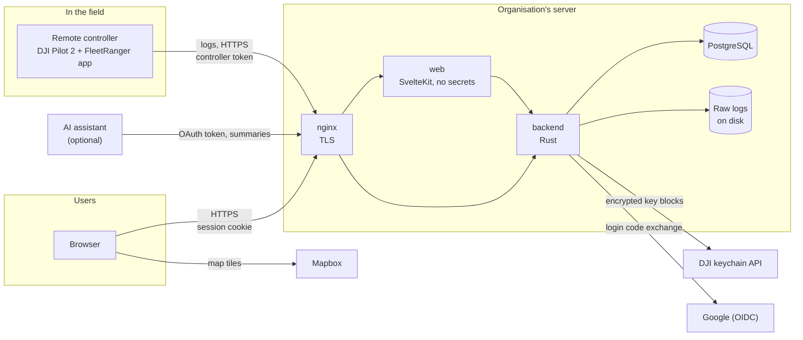
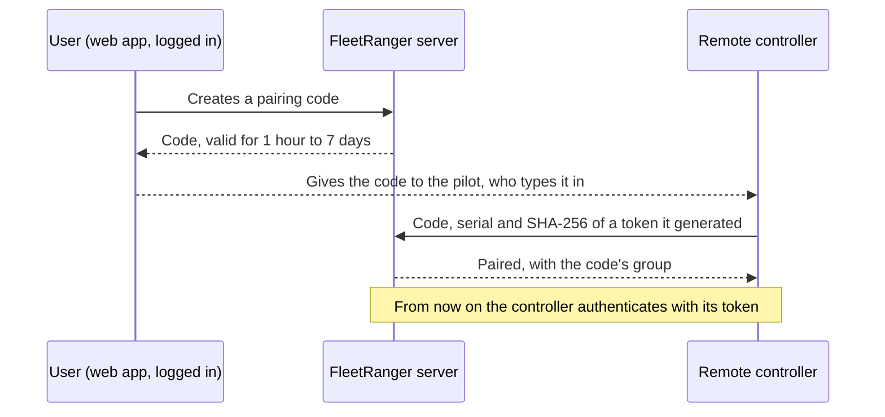
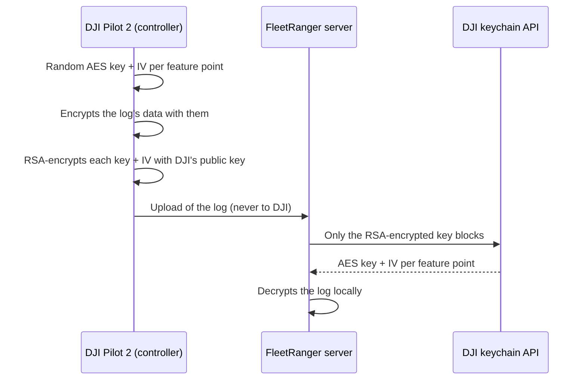

# Security and data flows

For security officers who evaluate FleetRanger. It describes where flight data goes, what leaves the install and how access works. Design decisions and their reasons are in [architecture.md](architecture.md); what is built and what isn't yet is in [roadmap.md](roadmap.md).

## Summary

- FleetRanger runs on the organisation's own server. There is no FleetRanger cloud service and no telemetry back to the developers.
- Flight logs go from the remote controllers to that server only. They are never sent to DJI or to anyone else.
- To decrypt a log, the server asks DJI for its keys. The request holds only encrypted key blocks from the log, with no positions, times or serial numbers (see [The DJI key request](#the-dji-key-request)).
- Raw logs and full telemetry are never shown to users, admins included. Users see derived data: times, distance, track and statistics.
- The other outside services are the login provider (Google), the map provider (Mapbox, from the browser) and, only when switched on, AI assistants through MCP.

## Architecture

- Three containers under Docker Compose: `backend`, `web` and `postgres`. They listen on `127.0.0.1` only; nginx on the host terminates TLS and proxies to them.
- The web app holds no secrets and has no database access. It calls the backend over the internal network and forwards the browser's cookie.
- Images are built on a developer machine and loaded onto the server over SSH; no image registry is involved. Only tagged commits are released.
- The source is public under AGPL-3.0, so all of this can be checked in the code.

## From controller to server

**Pairing.** The FleetRanger app is downloaded on the controller from the install's own download page. A logged-in user creates a pairing code in the web app and gives it to the pilot, who types it into the controller. Nobody logs in on the controller, which is shared, nor in the field.

- The controller generates its own long random token and sends only its hash. The server stores only the hash.
- A code pairs one controller and is deleted when it's used, revoked or expired. Its creator, or whoever manages the group's controllers, can revoke it until then.
- A code is 8 characters (about 40 bits), so guessing is limited: nginx allows 10 pairing attempts a minute per address (with a burst of 5), as it does for OAuth registration. There is no limit across all addresses (the user's decision, 2026-10-23), so many addresses together could guess faster; a successful guess yields a controller token, which can read the pilot list and upload logs but not read flights, and the code's rightful user finds it used.
- The token allows exactly two things: downloading the pilot list and uploading logs. It can't read flights or anything else.
- Unpairing, on the controller or by whoever manages the group's controllers, stops the token immediately.

**Uploads.**
- Uploads use HTTPS to the install's public address, nothing else.
- They go over the connections chosen on the controller: unmetered Wi-Fi (the default), approved Wi-Fi networks only, or any connection.
- Before uploading, the controller sends the SHA-256 of its logs and uploads only those the server lacks.
- Logs are stored as they arrive, byte for byte, and are never modified.

## Identity and access

**Login.**
- Login uses OpenID Connect (Google first): authorization code flow with PKCE, run by the backend.
- There is no open sign-up. An admin gives a user a login by email. The first login with that verified address ties it to the provider's permanent subject ID, and later logins match on that ID only. So a reassigned or renamed address can't take over a login.
- Login sessions are a random token in an `HttpOnly`, `Secure`, `SameSite=Lax` cookie. The database stores only its SHA-256 hash. Sessions expire after 30 days without use and can be revoked immediately; archiving a user or removing their login revokes them.

**Roles.** An organisation can be divided into groups, which hold flights, sessions, drones and controllers; what isn't in a group is directly in the organisation. A user gets roles in groups, on the whole organisation, or both, and holds what their roles together allow:

| Role | Sees | Changes |
|---|---|---|
| Viewer | The flights and equipment | Nothing |
| Pilot | Their own flights | Nothing; is offered as a pilot and pairs controllers |
| Editor | The flights and equipment | Pilot, session and archiving of flights; names of equipment; pairs controllers |
| Admin (whole organisation only) | Everything | Users, roles, groups, equipment, areas, any flight |

- A pilot always sees their own flights. Equipment is also seen by whoever sees one of its flights.
- Every access decision goes through one policy module in the backend. Service functions take the acting user, so a handler can't skip the check.
- Users with flights are archived, never deleted, so history keeps referring to them. An archived user can't log in. A group can be deleted only once it's empty.

## Data on the server

| What | Where | Who can see it |
|---|---|---|
| Raw logs, as uploaded | Files on disk | Nobody through the app; only the server's operators |
| Flights: times, distance, track (one point per second), serials | PostgreSQL | Per the roles above |
| DJI key requests and responses, exactly as sent and received (API key left out) | PostgreSQL | Only the server's operators |
| Users, groups, roles, equipment | PostgreSQL | Names to users; management to admins |
| Login data: email, provider subject ID, session hashes | PostgreSQL, apart from the rest | Only the server's operators |

- Raw logs are kept so that flights can be re-derived when the parser improves. They are never offered for download.
- Secrets created on the server (database password, signing keys) never leave it. External secrets (DJI app key, OIDC client secret) are kept in an encrypted Ansible vault.

## What leaves the server

| Service | Who connects | What is sent | Why |
|---|---|---|---|
| DJI keychain API (`dev.dji.com`) | Backend | One request per log: encrypted key blocks, log format version, app number, API key | To decrypt the log |
| Google | Browser and backend | The login: Google learns who logs in and when | Login (OIDC) |
| Mapbox | Browser | Map tile requests, so Mapbox learns roughly which area is viewed. Tracks are drawn in the browser and never sent | Maps |
| AI assistant's provider | Assistant, through `/mcp` | Flight summaries the user asks for (no raw logs, telemetry, tracks or locations) | Optional; off unless the install switches it on |
| Apps | App, through `/api/v1`, as a user who connected it | What the app's scopes reach of what that user sees: summaries and names, and with `areas:read` the areas' boundaries; the user's roles in that app, and the names of the groups where they hold one (no raw logs, telemetry, tracks or takeoff points) | Optional; off unless the install switches it on |

Nothing else: no analytics, error reporting or update checks to outside services. The controller app talks only to its install; it gets updates from the install too, and a person confirms each one.

## The DJI key request

DJI flight logs (format version 13 and up) are encrypted. DJI Pilot 2 creates a fresh AES-256 key and IV for each "feature point" (a category of data) and locks them with DJI's RSA public key. The result is stored in the log as a KeyStorage record. Only DJI can unlock them, so reading a log needs DJI's keychain API.

**What a request contains.** Every request we have stored is exactly 4,244 bytes, and every byte is accounted for:

| Part | Bytes |
|---|---|
| 10 key blocks, 256 bytes each, in base64 | 3,440 |
| 10 feature-point names, fixed labels such as `FR_Standardization_Feature_Battery_13` | 365 |
| JSON field names and punctuation per entry, 38 × 10 | 380 |
| Commas between entries | 9 |
| `version` (the log format, always 4), `department` (which DJI app wrote the log) and the brackets | 50 |

The HTTP headers add the install's DJI API key, the content type and the HTTP client's standard headers.

**What a key block contains.** Each block is RSA-2048 with PKCS#1 v1.5 padding. Inside are 52 bytes: the 32-byte AES key and the 16-byte IV, each with its length. The rest of the 256 bytes is padding from the operating system's random source. The app generates the key and IV when it writes the log, from nothing else: no serial numbers, positions, times or other log data.¹

**What DJI sends back.** For each of the 10 feature-point names, a 32-byte AES key and a 16-byte IV: exactly what was in the key blocks. Every response we have stored holds 10 such pairs, all different.

**What DJI can learn.**
- That the install's API key asks for keys, how often, and from which IP address. One request goes out per log, shortly after the log arrives.
- Which DJI app wrote each log.
- With the returned keys DJI could read a log it got hold of. FleetRanger never sends one.

Every request is stored exactly as sent, with the response. An operator can check all of the above on their own install.

¹ Verified in the code of DJI Pilot 2 version 17.3.0.21 (October 2026), and consistent with the fixed size of every request we have seen. The app's flight record library uses [LibTomCrypt](https://github.com/libtom/libtomcrypt), a widely used open-source cryptography library, for the RSA encryption, the padding and the random source. Those functions are public code, so how the key blocks are built can be read in its source.

## Operations

- The server is managed through Ansible, not by hand.
- Server releases are tagged commits (`vX.Y.Z`), and the deploy script refuses an untagged commit or uncommitted changes.
- Controller app releases are tagged separately (`android-vX.Y.Z`) and signed with one release key, which is kept outside the repository.
- The controller app installs updates only from its own install, through Android's installer, with the person holding the controller confirming.

## Limits and open items

- **DJI Pilot 2 itself** talks to DJI separately, for example for activation, no-fly zones and firmware updates. FleetRanger can't see or change that traffic, and this document doesn't cover it.
- **Not built yet:**
    - an audit log of views and changes;
    - backups of the database and raw logs;
    - a vault that developers can't decrypt;
    - restricted developer access to servers.

  The [roadmap](roadmap.md) lists them under "Before production use".
- **A lost radio link** between drone and controller leaves a gap in the log, because DJI Pilot 2 writes the log from what it receives. FleetRanger bridges a gap in the air with a straight line, and counts it as air time.
