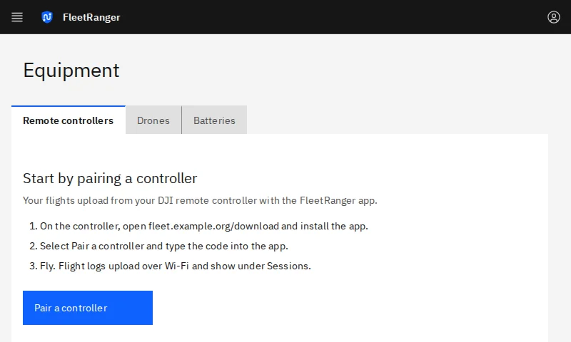
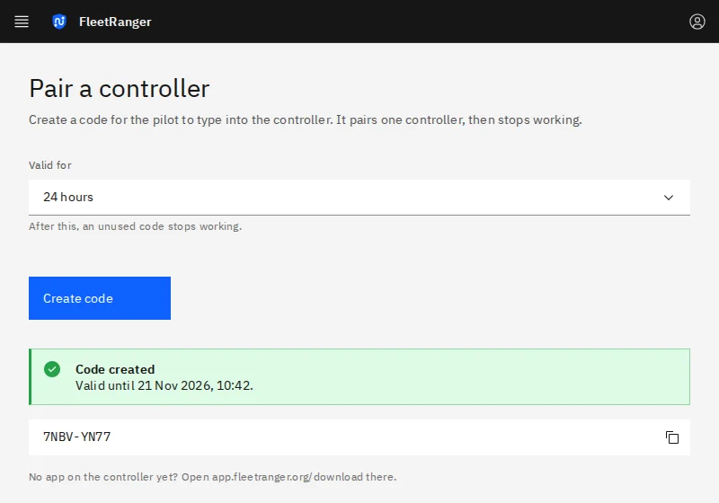
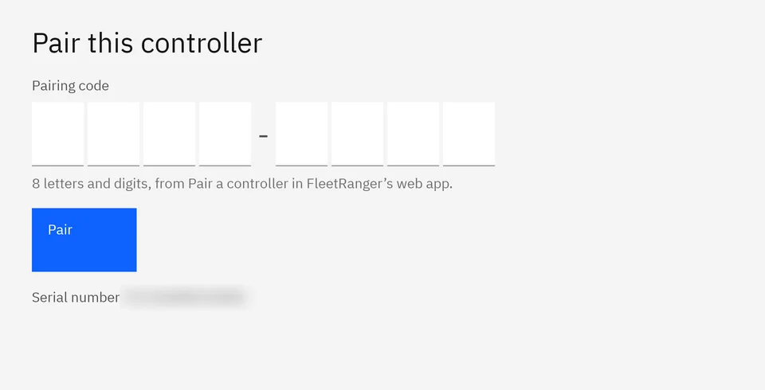
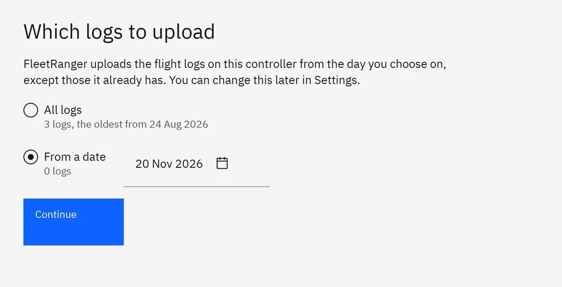
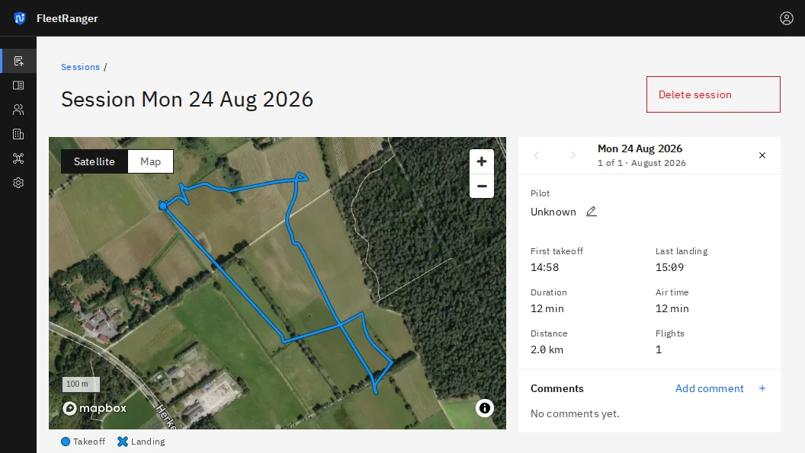

# Getting started

These steps get your first flight into FleetRanger: put the app on your DJI remote controller, pair it, and fly.

Until your organisation has its first flight, FleetRanger opens on **Equipment** with these steps.

## Install the app on the controller

1. On the controller, open **Firefox** and go to your FleetRanger address followed by `/download`, such as `app.fleetranger.org/download`.

   

2. Select **Download app**. When Firefox has downloaded it, select **Open**.
3. The first time, Android says it may not install apps from this source. Select **Settings**, turn on **Allow from this source**, and go back.
4. Select **Install**, then **Open**.

## Pair the controller

1. In the web app, open **Equipment** and select **Pair a controller**, then **Create code**.

   

2. On the controller, type the code and select **Pair**.

   

3. The app says **Paired**. Select **Continue**.

   

4. Allow the app to read the flight logs when it asks, and choose which logs to upload.

   

## Open FleetRanger at startup

So that pilots always start in FleetRanger, select **Open Android settings** in the app and choose **FleetRanger**:

## Fly

On **Who's flying?**, choose the pilot and select their tile: the app opens DJI Pilot 2. Fly as usual: after the flight, the app uploads the flight log by itself.

## See the flight

The flight shows under **Sessions** in the web app. See [Sessions](03-sessions.md).

To add pilots and other people, see [Users](05-users.md).
