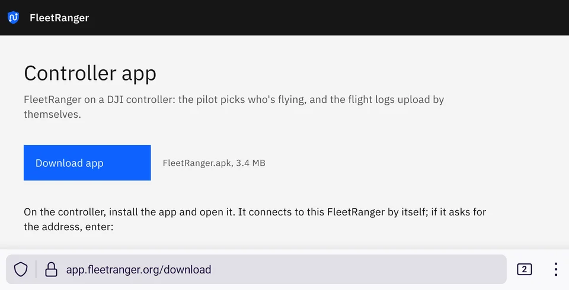
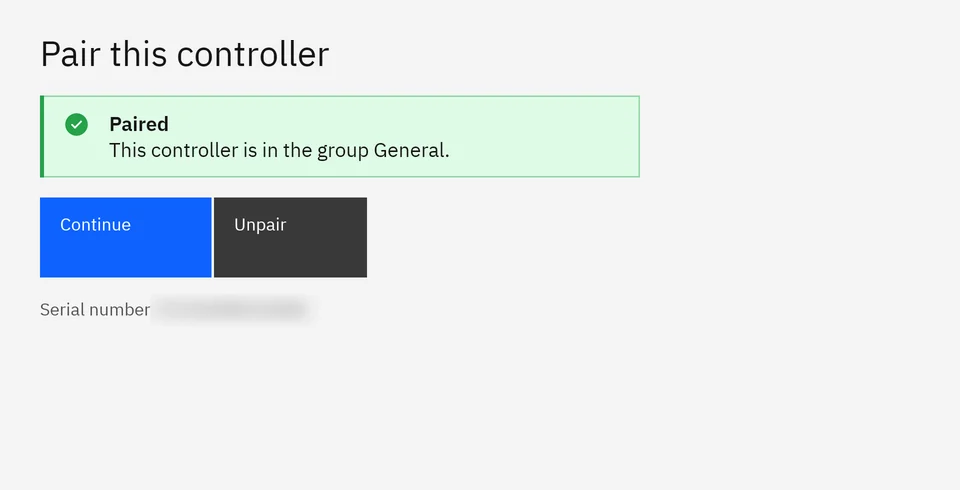
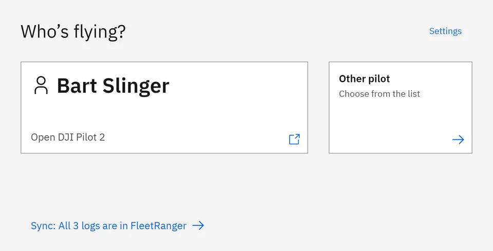
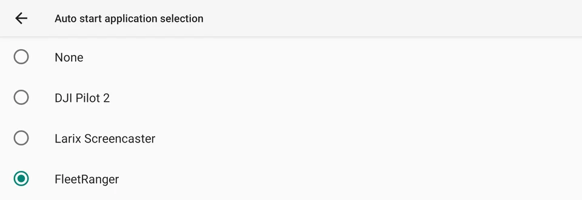

# Getting started

You have just logged in to your new organisation. These steps get the first flight in: put FleetRanger's app on a DJI remote controller, pair it, fly, and see the flight in a session.

Until your organisation has its first flight, FleetRanger opens on **Equipment**, which shows these steps under **Start by pairing a controller**.

## Before you start

The controller app shows a list of pilots to choose from. It holds everyone with the **Pilot** role. If you fly yourself, give yourself that role first: open **Users**, select your name, select **Edit user**, tick **Pilot** and **Save**. See [Users](05-users.md) to add other pilots.

## Install the app on the controller

1. On the controller, open **Firefox** and go to your FleetRanger address followed by `/download`, such as `app.fleetranger.org/download`.

   

2. Select **Download app**. When Firefox has downloaded it, select **Open**.
3. The first time, Android says it may not install apps from this source. Select **Settings**, turn on **Allow from this source**, and go back.
4. Select **Install**, then **Open**. FleetRanger already knows your address.

## Pair the controller

Pairing connects the controller to your organisation. You create a code in the web app and type it on the controller.

1. In the web app, open **Equipment** and select **Pair a controller**.
2. Choose how long the code is **Valid for** (24 hours unless you change it). If your organisation has several groups, also choose the **Group** the controller joins.
3. Select **Create code**. The code has 8 letters and digits, such as `KDW4-9TXR`.

   

4. On the controller, type the code under **Pairing code** and select **Pair**.

   

5. The app says **Paired** and which group the controller is in. Select **Continue**. If the group is wrong, select **Unpair** and pair again with a new code.

   

A code pairs one controller, then stops working. Unused codes are listed under **Open codes** on the same page, where you can revoke them.

## Allow access to the flight logs

The first time, the app asks for access to the flight logs that DJI Pilot 2 keeps on the controller. Select **Continue**, and choose **Allow** when Android asks. FleetRanger only reads the flight logs.

Next, choose **Which logs to upload** and select **Continue**:

- **All logs**: every flight already on the controller.
- **From a date**: the logs from the chosen day on. Today is chosen to begin with.

Each choice shows how many logs it covers. FleetRanger skips the logs it already has. You can change the choice later in the app's [settings](02-controller-app.md#sync).

## Choose who's flying

The app's main screen asks **Who's flying?** The first time, it lists every pilot, and **Not in the list** for flights whose pilot is set later in the web app. Select the pilot.

The pilot then shows on a big tile, with **Other pilot** beside it for someone else. Select the tile to open DJI Pilot 2. If the pilot flies for several groups, the tile first leads to **Log flights under**, where you select the group the same way. Next time, the last pilot is already on the tile, so the same pilot again is one tap. See [Controller app](02-controller-app.md) for the rest of the app.

**Open Android settings**, in the notice at the top, leads to this setting. Choose **FleetRanger**:

## Fly

Fly with DJI Pilot 2 as usual. After the flight, the app uploads the flight log by itself. By default it uploads over Wi-Fi networks that aren't metered; the app's **Settings** can allow other networks. The main screen shows how the upload is going, after **Sync:**.

## See the flight in a session

Once a log has been uploaded, FleetRanger reads it, which takes a moment. Admins see this as **Log processing** at the top of the page.

The flight then shows under **Sessions**. Flights by the same pilot with short breaks in between form one session. See [Sessions](03-sessions.md).

## Invite other people

Add the people who log in or fly under [Users](05-users.md). Pilots don't need a login: a name and the **Pilot** role put them in the controller's list.
