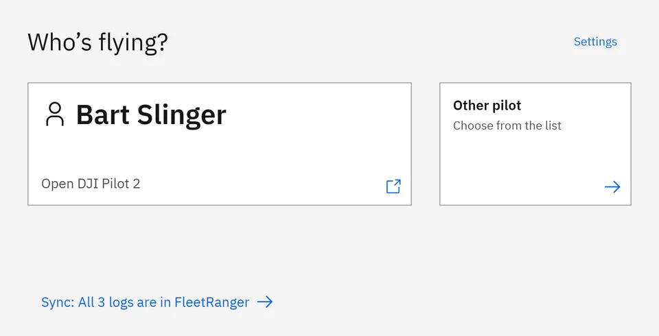
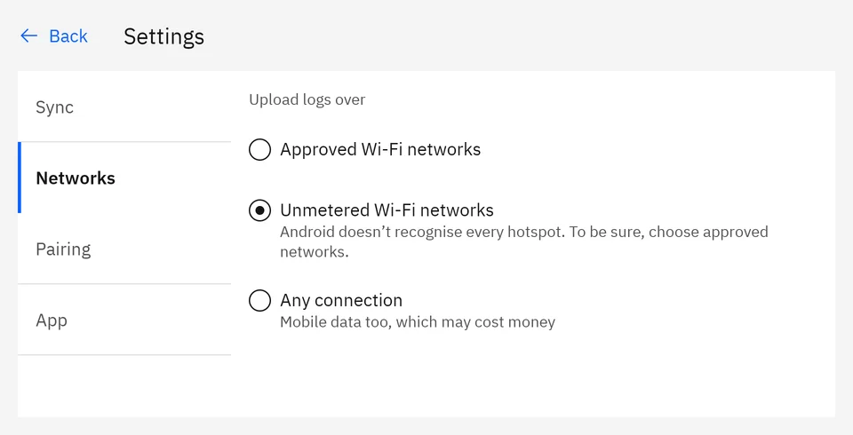

# Controller app

FleetRanger's app runs on the DJI remote controller. Pilots say who's flying before they open DJI Pilot 2, and the app uploads the flight logs afterwards by itself. [Getting started](01-getting-started.md) shows how to install and pair it.

## The main screen

The app opens on **Who's flying?** Select the pilot's tile to open DJI Pilot 2, or **Other pilot** for someone else.

At the bottom, **Sync:** says how the uploads are going.

## Settings

**Settings**, at the top right of the main screen, has four tabs.

### Sync

How many logs are in FleetRanger. **Sync logs from** chooses which logs to upload: all of them, or those from a date on.

### Networks

Which connections the app uploads over. By default it's Wi-Fi networks that aren't metered.

### Pairing

The FleetRanger server the controller uploads to. **Unpair controller** stops the uploads until it's paired again.

### App

The app's version. The app checks for updates by itself and shows when one is available.

