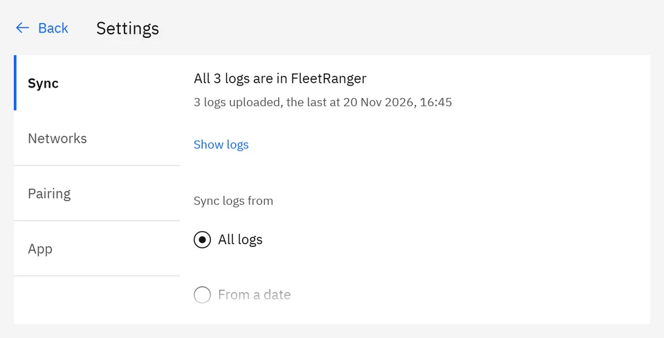
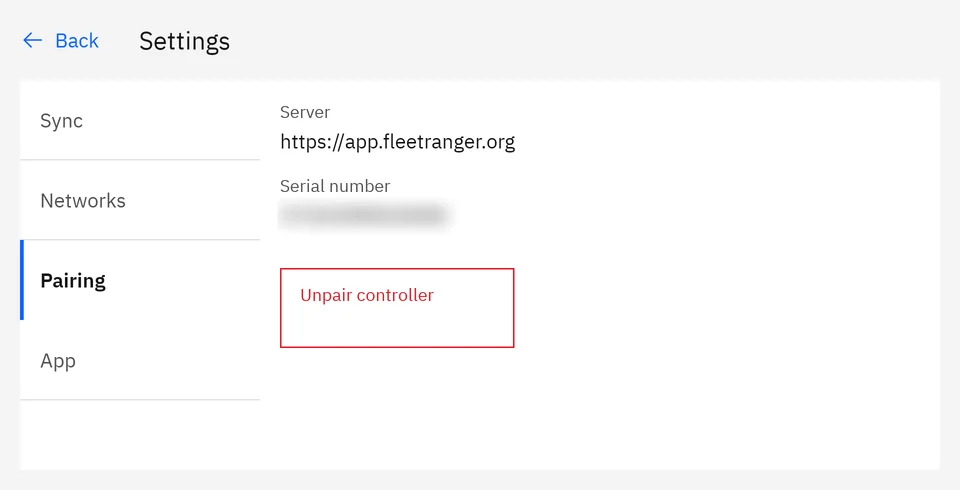
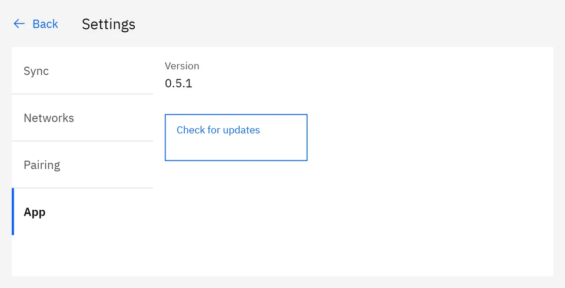

# Controller app

FleetRanger's app runs on the DJI remote controller. Pilots say who's flying before they open DJI Pilot 2, and the app uploads the flight logs afterwards by itself. [Getting started](01-getting-started.md) shows how to install and pair it.

## The main screen

The app opens on **Who's flying?** Select the pilot's tile to open DJI Pilot 2, or **Other pilot** for someone else. **Not in the list** uploads the flights without a pilot; an editor or admin sets it later in the web app.

At the bottom, **Sync:** says how the uploads are going; select it for the details. When a newer version of the app is out, **Update available** shows beside it.

The app shows a notice at the top when something needs attention:

- **FleetRanger doesn't open at startup**: select **Open Android settings** and choose FleetRanger, so the app opens when the controller switches on.
- **No flight logs found**: DJI Pilot 2 may keep them in another folder. Select **Search controller**; the app keeps the folder it finds.
- **No flight logs on this controller**: nothing was found anywhere. If you have flown already, contact the person named in the notice.
- **Can't read the flight logs**: the app has no access to them. Contact the person named in the notice.

## Settings

**Settings**, at the top right of the main screen, has four tabs.

### Sync

How many logs are in FleetRanger, and when the last one was uploaded. **Show logs** lists the flight logs on the controller, each with its state: **Uploaded**, **Waiting** for a connection, **Being written** while DJI Pilot 2 still writes it, or **Before the sync date**.

**Sync logs from** chooses which logs to upload: **All logs**, or **From a date**. Logs FleetRanger already has are never uploaded again.

### Networks

**Upload logs over** chooses the connections the app uploads over:

- **Approved Wi-Fi networks**: only the networks you add here. Connect to the network and select **Add**. Android needs location access to show the network's name; FleetRanger doesn't use the location.
- **Unmetered Wi-Fi networks**: any Wi-Fi network Android doesn't count as metered. This is the default. Android doesn't recognise every hotspot, so choose approved networks to be sure that a phone's hotspot isn't used.
- **Any connection**: mobile data too, which may cost money.

### Pairing

The FleetRanger server the controller uploads to, and the controller's serial number. **Unpair controller** stops the uploads until the controller is paired again with a new code. Logs already uploaded stay in FleetRanger.

### App

The app's version, and **Check for updates**. The app also checks by itself, when it comes to the front and once a day. To update, select **Update the app**: it downloads the new version from your FleetRanger server, and Android asks you to confirm the install.

