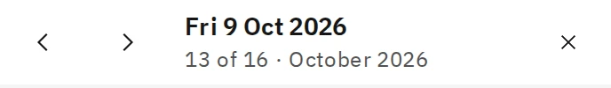

# Sessions

A session is one pilot's flights in a row, such as a morning's work. FleetRanger opens on **Sessions**: it is where you see what was flown.

Flights join a session by themselves when they come in: a flight by the same pilot shortly after the last one joins that session, otherwise it starts a new one.

## Browse sessions

Choose **Cards** or **Table** at the top right. Cards show a week or a month beside a map of their tracks; use the arrows for the previous or next period. **Filters** narrows the list, for example to one pilot or drone.

## A session

Select a session to open it: its times, air time and distance, a map of the tracks, and its flights. Select a flight to open it in [Flights](04-flights.md).

The bar above its figures moves you on:

- The arrows go to the previous and next session, keeping your filters, also into other weeks or months.
- Below the date, **13 of 16** says which session of the period this is.
- **✕** closes the session and takes you back to the list.

## Change a session

Editors and admins can change a session:

- The pencil beside the pilot sets the pilot of all its flights.
- Select flights in its table to move them to a new session or take them out.
- **Delete session** removes the session; its flights stay in [Flights](04-flights.md).
- To merge sessions, select them in the **Table** view and select **Merge sessions**.

## Comments

Comments keep a record of what happened in a session, such as the weather or the task. Select **Add comment** to write one.
